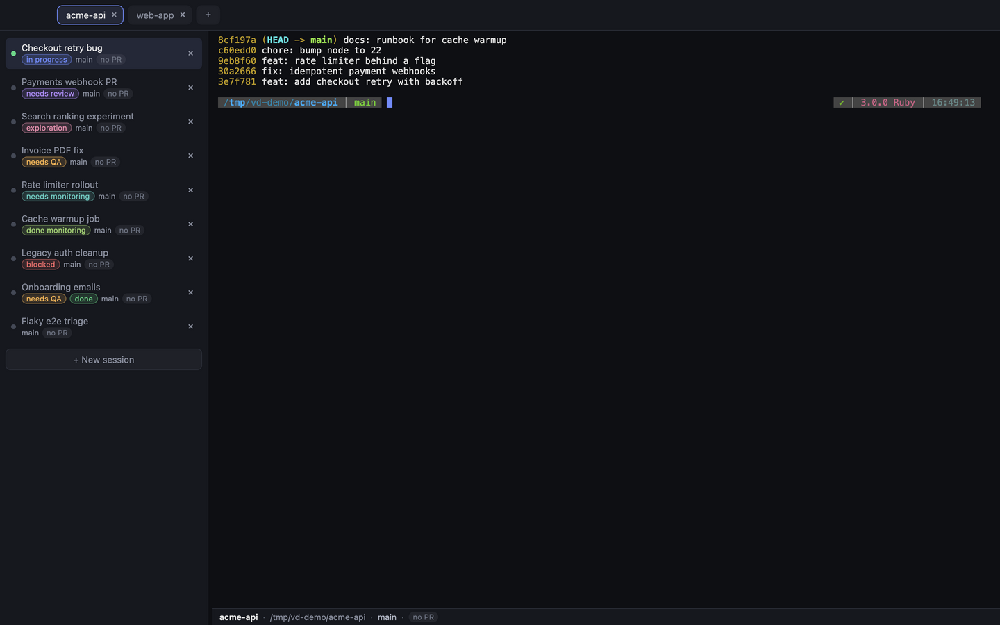
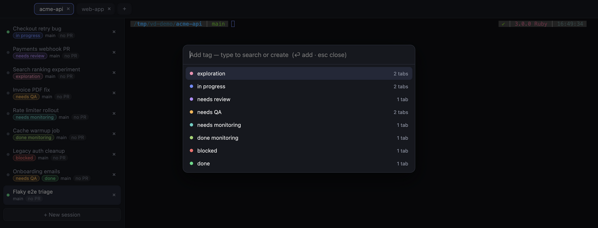
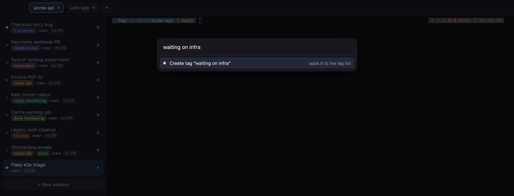
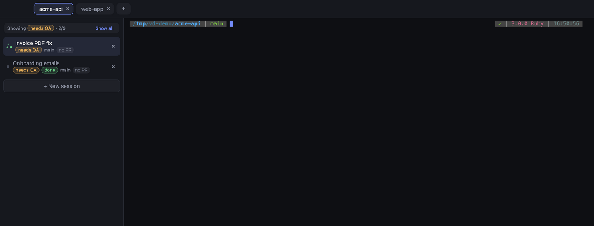
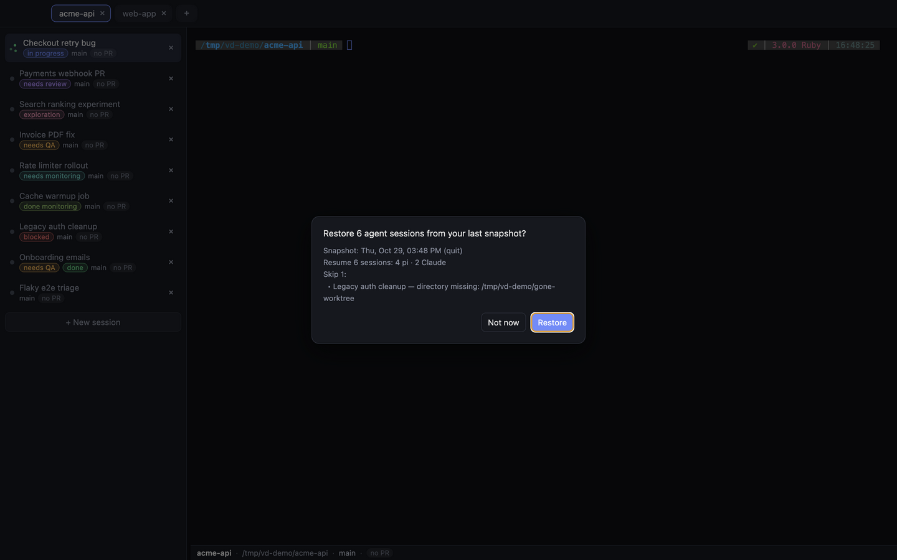
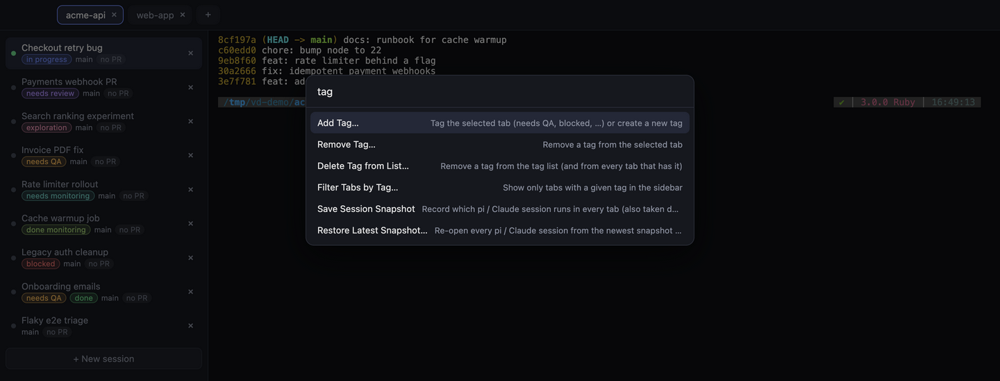

# VibeDeck

A lean macOS terminal built for running many coding agents at once — organized in two dimensions, with every tab showing what's going on in it.



- **Scopes** (top bar) — one per project/folder. Switching scopes swaps which sessions you see.
- **Sessions** (sidebar) — terminal tabs within the active scope. Run whatever you like in them: a shell, a coding agent (Claude Code, pi, …), a dev server.

Each session is your login shell running on its own pty, wired straight to the terminal — the same way a native terminal (Warp/iTerm/VS Code) works — so rendering is clean and fast, and modern TUIs behave exactly as they would anywhere else.

> A session's scope is an organizational label (its default working directory). It does **not** sandbox the session — any session can still touch any file on your machine.

## Features at a glance

| | |
|---|---|
| 🏷️ **Session tags** | Mark tabs `in progress`, `needs review`, `needs QA`, `blocked`, … or your own tags; filter the sidebar by tag |
| 🌿 **Worktree, branch & PR on every tab** | Each tab follows its shell's `cd` and shows the git branch and GitHub PR state |
| 💾 **Agent session snapshots** | Remembers which pi / Claude Code conversation runs in which tab and brings them all back after a quit or reboot |
| ⌨️ **Command palette** | ⌘⇧P for every action; ⌘P to fuzzy-find and open repos |
| ✍️ **Auto-named tabs** | Tabs name themselves from the terminal title — with the pi extension, from the first meaningful prompt (double-click to rename) |
| 🖼️ **Agent-friendly terminal** | ⇧⏎ newlines, paste an image as a file path, ⌘-click links, kitty keyboard protocol |

## Session tags

When a dozen agents are running, the question is *which ones need me?* Tags answer it at a glance: colored pills on each tab's second line.



- **Add Tag…** (⌘⇧P) — pick from the shared tag list. Type to search; the closest match is preselected.
- **Starts with a useful list:** `exploration`, `in progress`, `needs review`, `needs QA`, `needs monitoring`, `done monitoring`, `blocked`, `done` — each with its own color.
- **Make your own:** type a name that doesn't exist yet and press Enter — it's created, added to the list for every tab, and given a stable color.

  

- **Remove a tag** — hover a pill and click its **×**, or ⌘⇧P → **Remove Tag…**.
- **Filter Tabs by Tag…** — show only the tabs with one tag (e.g. everything that `needs QA`). Switching sessions (⌘⇧' / ⌘⇧\\, ⌘1–9) stays within the filtered tabs; **Show all** clears it.

  

- **Delete Tag from List…** — retire a tag everywhere (asks first if tabs still use it).
- Tags are saved with your layout and in agent session snapshots, so they survive restarts and restores.

## Worktree, branch & PR tracking

Every tab shows the **branch** its shell is on and the state of that branch's **GitHub PR** (open, draft, merged, closed — or `no PR`). VibeDeck tracks the shell's current directory through prompt integration (OSC 7), so the badges follow the session across `cd`s and into git worktrees. Agents can also report the worktree they're working in (see the pi companion extension below). PR data comes from your local `gh` CLI when it's installed and authenticated; otherwise the badge quietly shows as unavailable.

⌘⇧P → **Set Worktree for Active Session…** pins a tab to a worktree by hand; **Refresh Git/PR Status** forces an update.

## Agent session snapshots

Quitting VibeDeck (or rebooting) kills the shells — but VibeDeck remembers which **pi** / **Claude Code** conversation was running in which tab and offers to resume them all on the next launch.



- **When:** once a day (checked every 15 min while the app runs), on quit (before the shells are killed), and on demand — ⌘⇧P → **Save Session Snapshot**. Empty snapshots (no agents running) are never written, so a fresh launch can't shadow a good one.
- **Restore:** on launch VibeDeck offers to restore the latest snapshot; any time later use ⌘⇧P → **Restore Latest Snapshot…** (or **Restore Snapshot…** to pick an older one). Each tab's shell types `cd <dir> && pi --session <id>` / `claude --resume <id>`, starting tabs ~1s apart. Tabs already running an agent are skipped, closed tabs are recreated (with their names and tags), and missing worktrees/session files are reported.
- **Flags:** `--dangerously-skip-permissions`, `--permission-mode`, `--model`, `--agent` (Claude) and `--provider`, `--model`, `--thinking` (pi) carry over; nothing else does (no prompts, no `--api-key`).
- **How agents are identified:** VibeDeck finds the agent process under each tab's shell. Claude Code's own `~/.claude/sessions/<pid>.json` gives the session id (resumed from the project directory recorded in its transcript); pi needs the companion extension (`integrations/pi/vibedeck-session-title.ts`), which registers its session in `<userData>/agent-registry/`. pi sessions started before the extension was installed need a `/reload` to be captured.
- **Storage:** `<userData>/snapshots/*.json` (last 14 daily + last 10 of each other kind).
- **Snapshot a running VibeDeck from outside** (e.g. before upgrading from a build without on-quit snapshots): `node scripts/snapshot-running.js`.

## Command palette

Two palettes, both fuzzy-searched:

- **⌘P — repos.** Register a **parent folder** like `~/git-repos` once, then fuzzy-search every git repo under it and press Enter to open it as a scope.
- **⌘⇧P — commands.** Tags, snapshots, rename, worktree, git/PR refresh — everything that isn't a keyboard shortcut lives here.



## Persistence

VibeDeck remembers your **layout** — scopes, session names, tags, and working directories — and restores it on the next launch, reopening a fresh shell in each session's directory. The shells themselves do **not** survive quitting the app: a process running in a session dies on ⌘Q. Agent conversations come back through [snapshots](#agent-session-snapshots); for anything else that must keep running across a restart, start `tmux` (or `screen`) inside a session yourself.

## Requirements

- macOS (developed/tested there; Linux likely works with minor tweaks)
- [Node.js](https://nodejs.org) 18+

## Install & run

```bash
npm install     # installs deps, rebuilds node-pty for Electron, vendors xterm assets
npm start
```

Open a repo as a scope with `⌘P` (or the `+` in the top bar), or open any folder manually. Then add sessions with **+ New session** in the sidebar (or ⌘T).

Optional: symlink the pi companion extension so pi sessions get auto-named tabs, worktree reporting, and snapshot support:

```bash
ln -s "$PWD/integrations/pi/vibedeck-session-title.ts" ~/.pi/agent/extensions/
```

## Build a macOS app

One command — build, install to `/Applications`, and launch:

```bash
npm run install-app
```

Or step by step:

```bash
npm run icon                  # (re)generate build/icon.icns from build/icon.svg — optional
npm run dist                  # -> dist/VibeDeck-<version>-arm64.dmg  (unsigned)
bash scripts/install-app.sh   # copy the built app into /Applications + launch
```

Prefer to install by hand? Open the `.dmg` and drag **VibeDeck** to Applications. The build is **unsigned**; a *downloaded* copy may be blocked on first launch — right-click the app → **Open** once, or run `xattr -dr com.apple.quarantine /Applications/VibeDeck.app`. (A locally built copy isn't quarantined.)

## How it works

```
Electron renderer (UI)  ──IPC──►  main process  ──►  node-pty  ──►  your login shell
   scopes × sessions                pty manager                       (zsh -l, in the scope's dir)
```

- Each session is a login shell on a dedicated pty; the terminal (xterm.js) talks straight to it — no multiplexer in between.
- The app owns the scope→session model (including the tag list and each tab's tags) in `state.json` in Electron's userData dir. That layout persists; the shells don't.
- VibeDeck tracks each session's current directory via terminal OSC 7 prompt integration, so worktree branch/PR badges follow the session even after `cd`.
- GitHub PR badges use the local `gh` CLI when it is installed and authenticated; failures degrade to a subtle unavailable state.
- The optional `integrations/pi/vibedeck-session-title.ts` companion extension lets pi emit contextual terminal titles (so VibeDeck can auto-name tabs from the first meaningful prompt), report its worktree, and register its session for snapshots.
- VibeDeck speaks the [kitty keyboard protocol](https://sw.kovidgoyal.net/kitty/keyboard-protocol/) so modified keys (like Shift+Enter) reach apps unambiguously, and ⌘V pastes a clipboard **image** as a temp-file path so agents can attach it.

## Keyboard

- `⌘P` — repo palette (search repos under your parent folders, open as a scope)
- `⌘⇧P` — command palette (tags, snapshots, rename, worktree, …)
- `⌘T` — new session in the active scope (or `Ctrl`+`Shift`+backtick, VS Code style) · `⌘W` — close the active session
- `⌘1`–`⌘9` — jump to a session in the active scope (within the tag filter, if one is on)
- `⌘⇧[` / `⌘⇧]` — previous / next scope (the top bar)
- `⌘⇧'` / `⌘⇧\` — previous / next session (the sidebar)
- `⌘C` / `⌘V` — copy the selection / paste · `⌘A` — select all
- `⇧⏎` (Shift+Enter) — insert a newline instead of submitting (works in Claude Code, pi, and any app that speaks the keyboard protocol)
- **Paste an image** — copy an image (screenshot, browser "Copy Image", …) and `⌘V`: VibeDeck saves it to a temp PNG and types the path, so Claude Code / pi attach it (like a drag-and-drop)
- `⌘`+click a terminal URL (`Ctrl`+click off macOS) — open the link in your default browser
- Drag session tabs in the sidebar to reorder them
- Double-click a scope or session tab to rename it (or ⌘⇧P → **Rename Current Tab…**)

## Roadmap

- Let agents set their own tab's tags (e.g. `needs review` when a PR opens)
- Opt-in persistent sessions (reattach a background shell across restarts)
- Split panes within a session
- Drag to reorder scopes
- Configurable theme and font

## License

MIT — see [LICENSE](LICENSE).
